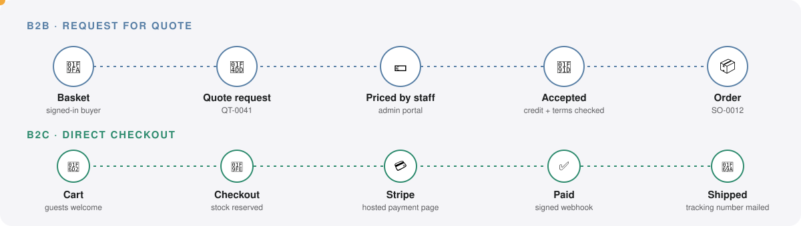
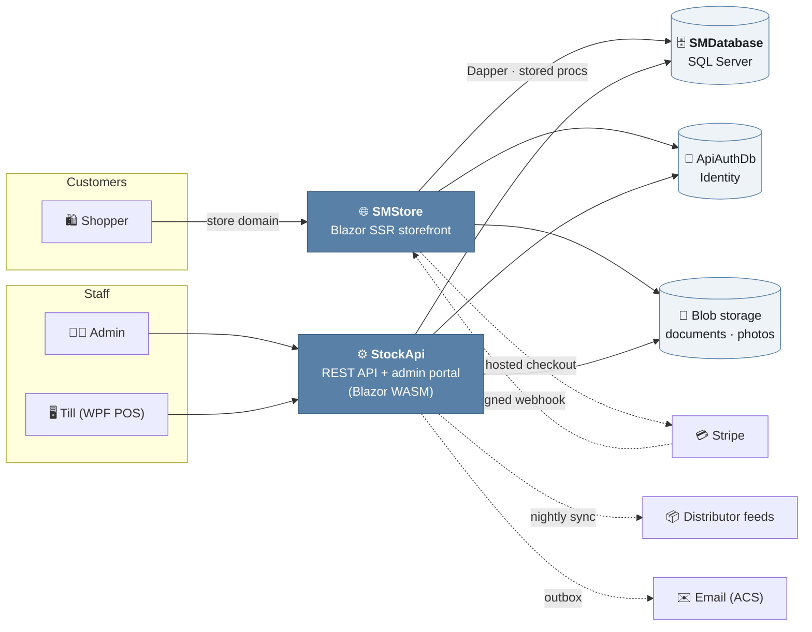

<div align="center">



<br/>

[](https://dotnet.microsoft.com/)
[](https://learn.microsoft.com/dotnet/aspire/)
[](https://dotnet.microsoft.com/apps/aspnet/web-apps/blazor)
[](https://www.microsoft.com/sql-server)
[](docs/runbooks/production.md)
[](LICENSE)

**A reusable B2B & B2C ecommerce platform with stock management at its heart.**<br/>
Stand up a new storefront — its own country, currency, tax rules, brand and catalogue — in days, not months.

[✨ Features](#-features) · [🧭 How it works](#-how-it-works) · [🚀 Quick start](#-quick-start) · [🧱 Projects](#-whats-inside) · [🧪 Tests](#-tests) · [📚 Docs](#-documentation)

</div>

---

## 💡 What is it?

StockManager started as a point-of-sale stock app and grew into a **multi-store commerce template**.
One deployment serves every store: each request is matched to its store by domain, and everything
that makes a shop *that* shop — country, currency, VAT rules, branding, categories, emails, payment
keys — is **configuration, not code**.

> 🏪 **Store #1** is a trade supplier in Ireland (B2B, quotes, €).
> 🇬🇧 **Store #2** is its UK sister (B2B, £, UK VAT).
> 👕 **Store #3** is a clothing shop in Brazil (B2C, card checkout, R$).
> ➕ **Store #4** is a [runbook](docs/runbooks/new-store.md), not a project.

## ✨ Features

<table>
<tr>
<td width="50%" valign="top">

### 🏬 Multi-store by design
- One deployment, many domains
- Per-store country, currency, locale & theme
- Stores created **closed** and opened against a checklist
- Admins act only for the stores they were given

</td>
<td width="50%" valign="top">

### 🤝 B2B trade
- Account applications with document upload & approval
- Customer groups with their own pricing
- Quote → price → accept → order round trip
- Payment terms, credit limits and printable documents

</td>
</tr>
<tr>
<td valign="top">

### 🛒 B2C shop
- Cart with guest checkout
- 💳 Stripe Checkout with signed webhooks
- 🚚 Delivery rates, tracking numbers & order emails
- 👕 Sizes, colours and product photographs

</td>
<td valign="top">

### 🧾 Tax that knows where it is
- `eu-b2b` — domestic, reverse charge or export
- `uk-b2b` — UK domestic, everything else export
- `flat` — one rate for a consumer shop
- Tax snapshotted onto every order as a legal record

</td>
</tr>
<tr>
<td valign="top">

### 🔄 Distributor feeds
- XML & CSV feeds over SFTP, synced nightly
- Stale stock hidden, delisted SKUs flagged — never deleted
- Failure & staleness alerts mailed to the operator
- Image enrichment in the background

</td>
<td valign="top">

### 🔐 Secure by default
- Strict CSP, no third-party scripts or fonts
- Rate-limited sign-in, registration & checkout
- Secrets encrypted with a shared, Key Vault-wrapped key ring
- Email outbox with retries & dead letters

</td>
</tr>
</table>

## 🧭 How it works

### Two ways to buy



Each store picks its ordering mode. A trade store takes **quote requests** that staff price in the
portal; a consumer store takes **card payments** straight from the cart. Same catalogue, same
orders table, same admin screens.

### Architecture



Everything is wired together by **.NET Aspire** — one command starts SQL Server, Azurite, the API,
the storefront and the dashboard.

## 🚀 Quick start

**You need:** the [.NET 10 SDK](https://dotnet.microsoft.com/download) and a container runtime
([Docker](https://www.docker.com/) or [Podman](https://podman.io/)).

```bash
git clone https://github.com/ChadiHD/StockManager.git
```

```bash
dotnet run --project StockManager.AppHost/StockManager.AppHost.csproj
```

Then open:

| | Where | What |
|---|---|---|
| 📊 | `https://localhost:17291` | Aspire dashboard — logs, traces, every resource |
| 🌐 | `https://localhost:7260` | Storefront |
| ⚙️ | `https://localhost:7042` | Admin portal & API |

> [!TIP]
> Emails don't leave your machine in development — confirmation and reset links appear in the
> `stock-api` log in the Aspire dashboard.

## 🧱 What's inside

| Project | Role |
|---|---|
| 🎛️ `StockManager.AppHost` | Aspire orchestrator — **the entry point** |
| ⚙️ `StockApi` | ASP.NET Core Web API; also serves the admin portal |
| 🌐 `SMStore` | Blazor SSR storefront, serving every store from one deployment |
| 🖥️ `SMPortal` | Blazor WebAssembly admin portal |
| 🗄️ `SMDatabase` | SQL project — tables, stored procedures, functions |
| 📚 `SMDataManager.Library` | Dapper data access shared by API and storefront |
| 🔑 `StockManager.Identity` | ASP.NET Identity schema |
| 🧩 `StockManager.ServiceDefaults` | Telemetry, health, Data Protection, mail and document stores |
| 🧾 `SMDesktopUI` | WPF point-of-sale till |

## 🧪 Tests

```bash
dotnet test StockManager.sln --filter "FullyQualifiedName!~StockManager.E2ETests&FullyQualifiedName!~SMDesktopUI"
```

| Suite | Covers |
|---|---|
| 🧮 `SMDataManager.Library.Tests` | Pricing, tax, staleness, T-SQL parity checks |
| ⚙️ `StockApi.Tests` | Controllers, authorization surface, store scoping |
| 🌐 `SMStore.Tests` | Storefront components across stores and ordering modes (bUnit) |
| 🖥️ `SMPortal.Tests` | Admin screens (bUnit) |
| 🎭 `StockManager.E2ETests` | 16 Playwright journeys driving the real app end to end |

## 📚 Documentation

- 🗺️ [Platform design](docs/plans/2026-07-24-aclitrade-b2b-ecommerce-design.md) and [build plan](docs/plans/2026-09-10-storefront-implementation-plan.md)
- 🏪 [Launching a new store](docs/runbooks/new-store.md)
- ☁️ [Production runbook](docs/runbooks/production.md)
- 🤖 [`CLAUDE.md`](CLAUDE.md) — the detailed engineering notes

## 📄 License

Released under the [GNU GPL v3](LICENSE). Built by **Chadi Hammoud**.
